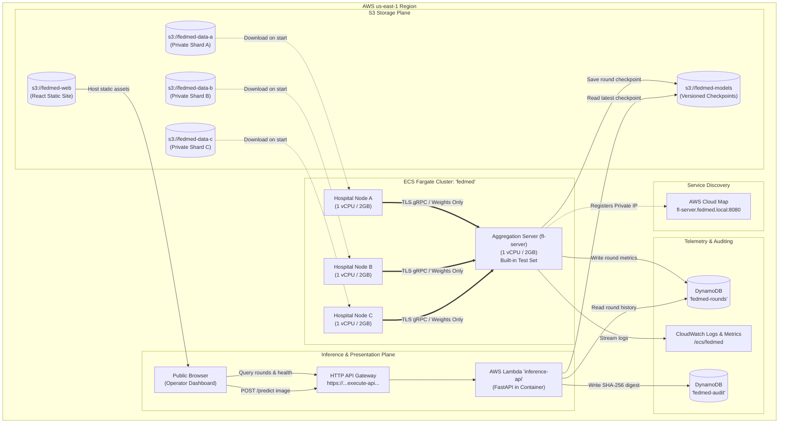

# FedMed: Complete Architectural, Algorithmic & Operational Manual

> **A Federated Cloud Platform for Privacy-Preserving Medical Image Intelligence**  
> Three hospitals train one pneumonia classifier on their combined experience without a single patient X-ray ever leaving the site that owns it. Built on AWS Fargate, Lambda, API Gateway, S3, and DynamoDB; engineered to run a full 10-round training demo for ~1.5 cents ($0.015), and survive an entire multi-week project lifecycle for under $3.00.

---

## Table of Contents

1. [Executive Summary](#1-executive-summary)
2. [The Healthcare Problem & Clinical Motivation](#2-the-healthcare-problem--clinical-motivation)
   - [Why Centralized Pooling Fails](#why-centralized-pooling-fails)
   - [The Non-IID Reality](#the-non-iid-reality)
   - [Dataset Provenance, Clinical Source & Specifications](#dataset-provenance-clinical-source--specifications)
3. [Algorithmic & Mathematical Foundations](#3-algorithmic--mathematical-foundations)
   - [Model Architecture & Why GroupNorm Over BatchNorm](#model-architecture--why-groupnorm-over-batchnorm)
   - [Federated Averaging (FedAvg) Formulation](#federated-averaging-fedavg-formulation)
   - [Non-IID Data Partitioning via Dirichlet Distribution](#non-iid-data-partitioning-via-dirichlet-distribution)
   - [Differential Privacy & Rényi DP Accounting](#differential-privacy--renyi-dp-accounting)
4. [High-Level Cloud & System Architecture](#4-high-level-cloud--system-architecture)
   - [System Topology & Data Flow](#system-topology--data-flow)
   - [Step-by-Step Training Lifecycle](#step-by-step-training-lifecycle)
   - [Architectural Design Decisions](#architectural-design-decisions)
5. [In-Depth Component Breakdown](#5-in-depth-component-breakdown)
   - [`common/fedmed/` (Shared Core Engine)](#commonfedmed-shared-core-engine)
   - [`hospital_node/` (Decentralized Participant)](#hospital_node-decentralized-participant)
   - [`fl_server/` (Federated Aggregator & Strategy)](#fl_server-federated-aggregator--strategy)
   - [`inference_api/` (Serverless Public Inference & Auditing)](#inference_api-serverless-public-inference--auditing)
   - [`dashboard/` (Real-Time Operator Console)](#dashboard-real-time-operator-console)
   - [`infra/` (Terraform Infrastructure as Code)](#infra-terraform-infrastructure-as-code)
   - [`scripts/` (Automation & Orchestration Suite)](#scripts-automation--orchestration-suite)
6. [Security, Privacy Boundaries & Threat Model](#6-security-privacy-boundaries--threat-model)
   - [Threat Actors & Assets](#threat-actors--assets)
   - [Defended Guarantees](#defended-guarantees)
   - [Honest Boundaries & Documented Limitations](#honest-boundaries--documented-limitations)
   - [Threat vs Mitigation Matrix](#threat-vs-mitigation-matrix)
7. [Cloud Financial Engineering & Cost Breakdown](#7-cloud-financial-engineering--cost-breakdown)
   - [Idle Cost at Rest vs Training Cost](#idle-cost-at-rest-vs-training-cost)
   - [Quantitative Architectural Comparison ($3 vs $120+/mo)](#quantitative-architectural-comparison-3-vs-120mo)
8. [Experimental Results & Empirical Evaluation](#8-experimental-results--empirical-evaluation)
   - [Benchmark Summary Table](#benchmark-summary-table)
   - [Deconstructing the Performance Penalties](#deconstructing-the-performance-penalties)
9. [Comprehensive Operational Runbook](#9-comprehensive-operational-runbook)
   - [Prerequisites & Development Environment](#prerequisites--development-environment)
   - [Local Development & Pytest Verification](#local-development--pytest-verification)
   - [Containerized Multi-Node Simulation (Docker Compose)](#containerized-multi-node-simulation-docker-compose)
   - [AWS Deployment: Two-Phase Terraform Workflow](#aws-deployment-two-phase-terraform-workflow)
   - [Launching Training Runs & Live Monitoring](#launching-training-runs--live-monitoring)
   - [Web Dashboard Deployment](#web-dashboard-deployment)
   - [Teardown & Credit Preservation](#teardown--credit-preservation)
   - [Troubleshooting Playbook](#troubleshooting-playbook)
10. [Repository File-by-File Index](#10-repository-file-by-file-index)
11. [Regulatory Notice & Disclaimer](#11-regulatory-notice--disclaimer)

---

## 1. Executive Summary

Modern deep learning has demonstrated remarkable success in diagnostic medical imaging, but clinical models suffer from two existential hurdles:
1. **Data Silos & Privacy Regulations**: Patient data cannot be centrally pooled due to legal and privacy mandates (HIPAA, GDPR, medical governance). De-identifying medical images is fundamentally insufficient because chest films often have burned-in metadata, anatomical anomalies, and biometric signatures.
2. **Data Scarcity & Heterogeneity**: Individual hospitals lack sufficient sample size and diversity. Furthermore, hospital populations are **Non-IID** (Non-Independent and Identically Distributed): a specialized pediatric clinic sees a vastly different case mix than an acute adult respiratory ICU.

**FedMed** is an end-to-end, production-grade cloud platform solving this challenge. By implementing **Federated Learning (FL)** orchestrated via **Flower (flwr)**, three independent simulated hospitals train a unified deep convolutional neural network for pediatric pneumonia detection without any hospital transmitting or exposing its raw chest X-ray images.

### Key Highlights
- **Zero Raw Data Transfer**: Patient images remain strictly within task-local ephemeral storage in hospital containers. Only mathematical weights and scalar metrics are exchanged over pinned TLS gRPC channels.
- **Serverless Cloud Economics**: Uses AWS ECS Fargate one-off tasks, AWS Lambda, API Gateway HTTP APIs, S3, and DynamoDB. Compute scales to zero immediately when training halts. A full 10-round training session costs **~$0.013 – $0.015**, and development over weeks costs **<$3.00**.
- **Rigorous & Transparent Differential Privacy**: Features server-side L2 gradient clipping and Gaussian noise injection with formal Rényi Differential Privacy (RDP) accounting. FedMed rejects "privacy theater" by explicitly surfacing exact $(\varepsilon, \delta)$ budgets.
- **Audited Zero-Retention Inference**: The public inference API operates completely in memory. It classifies uploaded scans and records only a SHA-256 cryptographic digest in DynamoDB for verifiable auditability without ever persisting patient pixels.
- **Interactive Hand-Crafted Dashboard**: Built with React and pure SVG charts (no heavyweight charting libraries), displaying real-time convergence curves, hospital class distribution bars, differential privacy metrics, a sample image gallery, and live drag-and-drop diagnostic classification.

---

## 2. The Healthcare Problem & Clinical Motivation

### Why Centralized Pooling Fails
In conventional machine learning, data from all participating institutions is collected into a centralized data lake (e.g., S3 bucket or cluster file system). In clinical medicine, this paradigm is legally, ethically, and practically unviable:
- **HIPAA Privacy Rule & GDPR Article 9**: Raw Protected Health Information (PHI) cannot be shared across organizational or international boundaries without patient consent or rigorous institutional review board (IRB) approvals.
- **The Failure of De-identification**: DICOM metadata can be stripped, but chest X-rays frequently contain burned-in radiological text (patient ID, clinic name, date), surgical hardware with serial numbers, pacemakers, and anatomical markers. Research has repeatedly demonstrated facial and patient reconstruction from medical scans.
- **Commercial & Competitive Liability**: Healthcare networks guard patient registries as proprietary institutional assets.

### The Non-IID Reality
In the real world, medical data is neither independent nor identically distributed:
- **Hospital A**: A large regional hospital with 3,419 scans and a 74.2% pneumonia prevalence.
- **Hospital B**: A specialized respiratory ward with 1,513 scans and a 96.0% pneumonia prevalence (predominantly diseased scans).
- **Hospital C**: A community primary care facility with 300 scans and a 15.0% pneumonia prevalence (predominantly normal scans).

A model trained solely on Hospital C will fail to detect pneumonia because it rarely encounters positive cases. Conversely, a model trained solely on Hospital B will simply learn to predict "pneumonia" for every input, scoring 96% local accuracy while remaining clinically useless. FedMed unites these disparate datasets into a single robust global model.

### Dataset Provenance, Clinical Source & Specifications

| Dimension | Details |
|---|---|
| **Benchmark Dataset** | **PneumoniaMNIST** (Standardized in the **MedMNIST v2** benchmark suite) |
| **Original Clinical Source** | Pediatric Chest X-Rays from **Guangzhou Women and Children's Medical Center** (Guangzhou, China) |
| **Original Scientific Publication** | *Kermany et al., "Identifying Medical Diagnoses and Treatable Diseases by Image-Based Deep Learning"*, ***Cell* 172(5)**, 1122–1131 (2018). [DOI: 10.1016/j.cell.2018.02.010](https://doi.org/10.1016/j.cell.2018.02.010) |
| **Benchmark Publication** | *Yang et al., "MedMNIST v2 - A large-scale lightweight benchmark for 2D and 3D biomedical image classification"*, ***Scientific Data* (Nature)**, 2023. [DOI: 10.1038/s41597-022-01721-8](https://doi.org/10.1038/s41597-022-01721-8) |
| **Public Repositories** | Mendeley Data & Kaggle: *Chest X-Ray Images (Pneumonia)* |
| **Image Resolution & Color** | **$64 \times 64$ pixels**, 8-bit single-channel grayscale |
| **Target Classes** | Binary classification: **`0: Normal`**, **`1: Pneumonia`** |
| **Total Cohort Size** | **5,856 total pediatric chest radiographs** |
| **Automated Retrieval** | Programmatically fetched in [scripts/partition_data.py](scripts/partition_data.py) using the official `medmnist` Python package (`from medmnist import PneumoniaMNIST`) |

#### Hospital Shard Breakdown (Dirichlet Non-IID Split, $\alpha=0.5$)
As recorded in [`data/partition_summary.json`](data/partition_summary.json), the 5,856 images are partitioned into three isolated hospital shards plus a centralized held-out evaluation set:

| Node / Split | Storage Path | Total Scans | Normal Scans | Pneumonia Scans | Pneumonia Ratio | Node Clinical Profile |
|---|---|---|---|---|---|---|
| **Hospital A** | [`data/hospital_a/shard.npz`](data/hospital_a/shard.npz) | 3,419 | 900 | 2,519 | **73.7%** | Large urban medical center, high volume, moderate disease prevalence |
| **Hospital B** | [`data/hospital_b/shard.npz`](data/hospital_b/shard.npz) | 970 | 42 | 928 | **95.7%** | Acute pediatric respiratory ICU, severe positive skew |
| **Hospital C** | [`data/hospital_c/shard.npz`](data/hospital_c/shard.npz) | 319 | 272 | 47 | **14.7%** | Outpatient community clinic, low volume, predominantly healthy scans |
| **Server Test Set** | [`data/server/test.npz`](data/server/test.npz) | 1,148 | 369 | 779 | **67.9%** | Held-out global test set baked into the aggregator image for uncorrupted scoring |

---

## 3. Algorithmic & Mathematical Foundations

### Model Architecture & Why GroupNorm Over BatchNorm

The classifier is `PneumoniaCNN`, a tailored convolutional neural network implemented in [common/fedmed/model.py](file:///c:/ankur%20arpan%20cloud/ankur%20arpan%20cloud/common/fedmed/model.py). It operates on single-channel grayscale $64 \times 64$ chest X-rays.

```
Input: (Batch, 1, 64, 64)
  │
  ├── Block 1: Conv2d(1 -> 16, 3x3, pad 1) ──▶ GroupNorm(4, 16) ──▶ ReLU ──▶ MaxPool2d(2x2)  [32x32]
  ├── Block 2: Conv2d(16 -> 32, 3x3, pad 1) ──▶ GroupNorm(8, 32) ──▶ ReLU ──▶ MaxPool2d(2x2)  [16x16]
  ├── Block 3: Conv2d(32 -> 64, 3x3, pad 1) ──▶ GroupNorm(8, 64) ──▶ ReLU ──▶ MaxPool2d(2x2)  [8x8]
  │
  ├── AdaptiveAvgPool2d(1x1)                                                                  [1x1]
  ├── Flatten() ──▶ Dropout(p=0.2) ──▶ Linear(64, 2)
  │
Output: Logits (Batch, 2)  [Normal, Pneumonia]
```

#### Why GroupNorm is Critical in Federated Learning
Standard computer vision architectures default to **Batch Normalization (BatchNorm)**. In federated learning across non-IID nodes, BatchNorm severely degrades performance:
1. **Running Statistics Skew**: BatchNorm maintains running estimates of mean $\mu$ and variance $\sigma^2$ accumulated over local minibatches. In a non-IID environment, Hospital B's running statistics reflect 96% diseased scans, while Hospital C's reflect 15%. Averaging these running buffers across sites corrupts the normalization layer.
2. **Tracked Batch Counter Conflicts**: BatchNorm tracks `num_batches_tracked` as integer buffers that cannot be cleanly averaged using weighted float operations.
3. **Stateless Normalization**: **Group Normalization (GroupNorm)** divides channel dimensions into smaller groups (e.g., 4 groups of 4 channels in Block 1) and computes mean and variance per-sample across spatial dimensions. It maintains **zero running state buffers**. The parameter list exchanged between client and aggregator contains strictly learnable weights ($W, b, \gamma, \beta$).

### Federated Averaging (FedAvg) Formulation

FedMed implements the classic McMahan et al. (2017) Federated Averaging algorithm within Flower:
1. **Initial Broadcast**: The server initializes global weights $w_0$ deterministically and broadcasts them to all participating clients $k \in \{1, \dots, K\}$.
2. **Local Training**: Each hospital node $k$ trains locally on its private dataset $\mathcal{D}_k$ with sample size $n_k$ for $E$ epochs using mini-batch SGD with Adam optimizer:
   $$w_{t+1}^k = \text{LocalSGD}(w_t, \mathcal{D}_k, E, \eta)$$
3. **Parameter Aggregation**: Each client returns its updated parameters $w_{t+1}^k$. The server computes the weighted average proportional to the dataset sizes where $n = \sum_{k=1}^K n_k$:
   $$w_{t+1} = \sum_{k=1}^K \frac{n_k}{n} w_{t+1}^k$$

### Non-IID Data Partitioning via Dirichlet Distribution

To faithfully simulate real-world clinical heterogeneity, [scripts/partition_data.py](file:///c:/ankur%20arpan%20cloud/ankur%20arpan%20cloud/scripts/partition_data.py) partitions the 5,232 training images of PneumoniaMNIST using a Dirichlet distribution:
- For each class $c \in \{0, 1\}$, a probability vector $\mathbf{p}_c = (p_{c,1}, \dots, p_{c,K})$ is drawn from a symmetric Dirichlet distribution parameterized by concentration $\alpha$:
  $$\mathbf{p}_c \sim \text{Dirichlet}(\alpha \cdot \mathbf{1}_K)$$
- A smaller $\alpha$ produces extreme non-IID class skew. At $\alpha = 0.5$, the generated shards reflect realistic clinical variation:
  - **Hospital A**: 3,419 images ($74.2\%$ pneumonia, $25.8\%$ normal)
  - **Hospital B**: 1,513 images ($96.0\%$ pneumonia, $4.0\%$ normal)
  - **Hospital C**: 300 images ($15.0\%$ pneumonia, $85.0\%$ normal)
- The script asserts that all shards are strictly disjoint ($\sum_k n_k = 5232$ with zero overlapping patient indices).

### Differential Privacy & Rényi DP Accounting

To safeguard model weights against gradient-inversion attacks, FedMed wraps FedAvg with server-side differential privacy ([fl_server/strategy.py](file:///c:/ankur%20arpan%20cloud/ankur%20arpan%20cloud/fl_server/strategy.py)):
1. **L2 Norm Clipping**: The update vector $\Delta w^k = w_{t+1}^k - w_t$ of each hospital is clipped to a maximum L2 threshold $C$ (default $C = 1.0$):
   $$\Delta \tilde{w}^k = \frac{\Delta w^k}{\max\left(1, \frac{\|\Delta w^k\|_2}{C}\right)}$$
2. **Gaussian Noise Addition**: The aggregated update is perturbed by zero-mean calibrated Gaussian noise:
   $$\tilde{w}_{t+1} = w_t + \sum_{k=1}^K \frac{n_k}{n} \Delta \tilde{w}^k + \mathcal{N}\left(0, \sigma^2 C^2 \mathbf{I}\right)$$
   where $\sigma$ is the noise multiplier (e.g., $0.05$).
3. **Rényi Differential Privacy (RDP) Accounting**: Implemented in [common/fedmed/privacy.py](file:///c:/ankur%20arpan%20cloud/ankur%20arpan%20cloud/common/fedmed/privacy.py). Computes cumulative RDP over order grid $\alpha \in [2, 512]$ and converts to standard $(\varepsilon, \delta)$-DP at $\delta = 10^{-5}$ using Canonne, Kamath, and Steinke (2020) conversion.

#### The Honest Privacy Budget Disclosure
In federated learning literature, low $\varepsilon$ values (e.g., $\varepsilon < 3$) depend on **subsampling amplification**, where only a small fraction $q = \frac{C}{K} \ll 1$ of clients participate per round.
- With $K=3$ hospitals all participating in every round, the sampling rate is $q = 1.0$ (no amplification).
- At $\sigma = 0.05$ (preserving ~87% accuracy), $\varepsilon$ calculates in the thousands.
- Increasing noise to achieve $\varepsilon < 50$ drops accuracy down to 33.0% (worse than random guessing).
- **FedMed's Design Principle**: Rather than pretending to be mathematically private, the dashboard and API report the exact computed $\varepsilon$ and explain why more participating sites are required for tighter theoretical bounds.

---

## 4. High-Level Cloud & System Architecture

### System Topology & Data Flow



### Step-by-Step Training Lifecycle

1. **Aggregator Task Initialization**: `./scripts/start_run.sh` launches `fl-server` as an ECS Fargate task with 1 vCPU and 2 GB RAM.
2. **Private IP Discovery**: The launch script polls until `fl-server` reaches `RUNNING` status, extracts its private IPv4 address from its Elastic Network Interface (ENI), and registers it into AWS Cloud Map under `fl-server.fedmed.local`.
3. **Hospital Tasks Launch**: Three hospital tasks (`hospital-a`, `hospital-b`, `hospital-c`) are spun up on Fargate. Each is injected with its specific `HOSPITAL_ID`, `DATA_BUCKET`, and DNS address.
4. **Local Ephemeral Shard Caching**: Each hospital downloads its private `shard.npz` (1-15 MB) into task-local ephemeral container storage. 15% is held out locally for validation; 85% is designated for training.
5. **Secure gRPC Handshake**: Hospitals connect to `fl-server.fedmed.local:8080` over gRPC with pinned TLS CA certificates. If the server is still initializing, hospitals employ an exponential backoff retry loop (up to 30 attempts).
6. **Round Execution (1 to 10)**:
   - Server distributes global weights $w_t$.
   - Hospitals train for 1 local epoch on their local shard and compute validation scores.
   - Hospitals transmit updated weights and training statistics back to the server.
   - Server clips updates to $L_2 \le 1.0$, averages them weighted by client sample counts, and injects Gaussian noise ($\sigma = 0.05$).
   - Server evaluates the aggregated model on its internal held-out test set (585 images).
   - Checkpoint is serialized to `s3://fedmed-models/global/round_XXX.npz` and `latest.npz`. Round metrics are committed to DynamoDB table `fedmed-rounds`.
7. **Graceful Auto-Termination**: After round 10, all four Fargate tasks exit cleanly. No compute resources linger; no idle billing occurs.

### Architectural Design Decisions

| Choice | Alternative Considered | Rationale & Defense |
|---|---|---|
| **AWS ECS Fargate One-Off Tasks** | EKS Kubernetes Cluster | EKS control plane costs ~$73/month before a single pod runs. Fargate bills per task-second (~$0.049/task-hour). The entire 4-task run takes 3.5 minutes and costs ~1.5 cents. |
| **One-Off Tasks** | Continuous ECS Services | ECS services restart tasks to maintain `desired_count=1`. Since FL training is a finite batch job, services would restart the aggregator infinitely and incur runaway costs. |
| **AWS Lambda for Inference** | Application Load Balancer + ECS | An ALB costs ~$16/month idle. Lambda scales to zero, staying well within the free tier for demo volumes. 2 GB RAM is allocated to provide 1.2 vCPUs for fast PyTorch startup. |
| **Public Subnets + Security Groups** | Private Subnets + NAT Gateway | A NAT Gateway costs ~$32/month plus data transfer fees. Placing tasks in public subnets with public IPs is free; security groups completely block all inbound internet traffic. |
| **AWS Cloud Map DNS** | Passing Hardcoded Container IPs | Fargate tasks receive ephemeral dynamic IPs. Cloud Map provides a stable internal domain `fl-server.fedmed.local`, which is mandatory for valid TLS hostname verification. |
| **Aggregator Test Set Baked into Image** | S3 Test Data Bucket | Storing the global test set inside `fl-server` ensures the aggregator needs zero read permissions on any hospital bucket, enforcing data isolation structurally at the IAM layer. |

---

## 5. In-Depth Component Breakdown

### `common/fedmed/` (Shared Core Engine)
A shared Python package mounted into all containers to enforce code uniformity:
- [config.py](file:///c:/ankur%20arpan%20cloud/ankur%20arpan%20cloud/common/fedmed/config.py): Strongly-typed dataclasses (`TrainingConfig`, `FederationConfig`, `PrivacyConfig`, `StorageConfig`, `TLSConfig`) populated from environment variables with sensible defaults.
- [model.py](file:///c:/ankur%20arpan%20cloud/ankur%20arpan%20cloud/common/fedmed/model.py): Defines `PneumoniaCNN`, `build_model(seed)`, and utility functions `get_weights()` and `set_weights()` converting between PyTorch state dicts and Flower NumPy parameter lists.
- [data.py](file:///c:/ankur%20arpan%20cloud/ankur%20arpan%20cloud/common/fedmed/data.py): Defines the `Shard` dataclass, NumPy archive loader, PyTorch `TensorDataset` / `DataLoader` generation, image preprocessing ($[-1, 1]$ normalization), and local evaluation loops (`train_local()`, `evaluate()`).
- [privacy.py](file:///c:/ankur%20arpan%20cloud/ankur%20arpan%20cloud/common/fedmed/privacy.py): Implements Rényi Differential Privacy (RDP) formulas for sampled and full-participation Gaussian mechanisms, converting noise multipliers to $(\varepsilon, \delta)$ budgets.
- [storage.py](file:///c:/ankur%20arpan%20cloud/ankur%20arpan%20cloud/common/fedmed/storage.py): Abstract base class `Storage` with two concrete implementations: `LocalStorage` (filesystem for tests and local Docker volumes) and `S3Storage` (AWS S3 with AES256 server-side encryption).
- [metrics.py](file:///c:/ankur%20arpan%20cloud/ankur%20arpan%20cloud/common/fedmed/metrics.py): Abstract sink for telemetry. `LocalMetrics` writes to `metrics.json`. `AwsMetrics` writes to DynamoDB (`fedmed-rounds`) and pushes custom CloudWatch metrics with dimensions.

### `hospital_node/` (Decentralized Participant)
The edge container representing a clinical site:
- [client.py](file:///c:/ankur%20arpan%20cloud/ankur%20arpan%20cloud/hospital_node/client.py): Subclasses `flwr.client.NumPyClient`.
  - Implements `get_properties()`, `get_parameters()`, `fit()`, and `evaluate()`.
  - In `fit()`, it applies local Adam optimizer over local training data, returning updated weights, sample count, and training loss/accuracy.
  - In `evaluate()`, it evaluates incoming global weights against its local 15% validation split.
  - Features robust retry mechanism (`connect_with_retry()`) to accommodate cluster startup delays.
  - Enforces zero image transmission: no network socket or file transfer logic exists for pixel data.
- [Dockerfile](file:///c:/ankur%20arpan%20cloud/ankur%20arpan%20cloud/hospital_node/Dockerfile): Minimal Python 3.10 slim container with PyTorch CPU and Flower.

### `fl_server/` (Federated Aggregator & Strategy)
The aggregation coordinator:
- [server.py](file:///c:/ankur%20arpan%20cloud/ankur%20arpan%20cloud/fl_server/server.py): Entry point for the Flower gRPC aggregation server. Loads the baked-in test dataset, initializes storage/metric sinks, and starts Flower via `fl.server.start_server()`.
- [strategy.py](file:///c:/ankur%20arpan%20cloud/ankur%20arpan%20cloud/fl_server/strategy.py): Implements custom FedAvg strategy logic:
  - `RoundRecorder`: Captures per-hospital metrics from `fit_metrics_aggregation_fn`.
  - `make_evaluate_fn()`: Server-side evaluation hook executed after aggregation. Crucially, checkpoints are written **here** rather than inside `aggregate_fit()`. This guarantees that if differential privacy is active, only the **noised** model is persisted to S3.
  - Wraps FedAvg with Flower's `DifferentialPrivacyServerSideFixedClipping`.

### `inference_api/` (Serverless Public Inference & Auditing)
The public HTTP serving gateway:
- [app.py](file:///c:/ankur%20arpan%20cloud/ankur%20arpan%20cloud/inference_api/app.py): FastAPI application:
  - `GET /health`: Returns status, active storage backend, and current model round.
  - `GET /model`: Returns model metadata, current global accuracy, loss, and active privacy budget ($\varepsilon, \delta$).
  - `GET /rounds`: Returns round-by-round convergence metrics from DynamoDB (or local file).
  - `POST /predict`: Accepts multipart image upload. Resizes to $64 \times 64$, converts to grayscale, runs inference using cached warm model in memory, and discards image bytes.
  - Cryptographic Audit: Calculates SHA-256 digest of uploaded bytes and commits `{request_hash, timestamp, predicted_label, model_round}` to DynamoDB table `fedmed-audit`.
  - Packaged via **Mangum** to run seamlessly inside AWS Lambda.
- [Dockerfile](file:///c:/ankur%20arpan%20cloud/ankur%20arpan%20cloud/inference_api/Dockerfile): AWS Lambda container image based on `public.ecr.aws/lambda/python:3.10`.
- [Dockerfile.local](file:///c:/ankur%20arpan%20cloud/ankur%20arpan%20cloud/inference_api/Dockerfile.local): Standard Uvicorn container for local Docker Compose simulation.

### `dashboard/` (Real-Time Operator Console)
Modern, lightweight React + Vite console:
- [App.jsx](file:///c:/ankur%20arpan%20cloud/ankur%20arpan%20cloud/dashboard/src/App.jsx): Main control center. Polls `/rounds` and `/health` every 5 seconds.
- [components/AccuracyChart.jsx](file:///c:/ankur%20arpan%20cloud/ankur%20arpan%20cloud/dashboard/src/components/AccuracyChart.jsx): Hand-crafted pure SVG chart. Renders the global test curve, individual hospital training curves, and the dashed centralized pooled baseline without external charting dependencies.
- [components/HospitalPanel.jsx](file:///c:/ankur%20arpan%20cloud/ankur%20arpan%20cloud/dashboard/src/components/HospitalPanel.jsx): Renders cards for each hospital showing scan count, pneumonia vs normal class balance bars, and real-time local loss/accuracy.
- [components/PrivacyPanel.jsx](file:///c:/ankur%20arpan%20cloud/ankur%20arpan%20cloud/dashboard/src/components/PrivacyPanel.jsx): Visualizes clipping norm, noise multiplier, sampling rate, and formal $(\varepsilon, \delta)$ budget.
- [components/ImageGalleryPanel.jsx](file:///c:/ankur%20arpan%20cloud/ankur%20arpan%20cloud/dashboard/src/components/ImageGalleryPanel.jsx): Visual catalog of sample chest X-rays (normal vs pneumonia from all hospitals and test set). Allows 1-click classification testing.
- [components/PredictPanel.jsx](file:///c:/ankur%20arpan%20cloud/ankur%20arpan%20cloud/dashboard/src/components/PredictPanel.jsx): Interactive drag-and-drop diagnostic testing zone. Displays probability gauge, prediction confidence, model round, and SHA-256 audit digest.

### `infra/` (Terraform Infrastructure as Code)
Declarative AWS infrastructure definitions specifically designed for AWS Academy Learner Lab environments:
- [main.tf](file:///c:/ankur%20arpan%20cloud/ankur%20arpan%20cloud/infra/main.tf): Sets up provider, tags (`Project = fedmed`), VPC, subnets, and security groups.
- [ecr.tf](file:///c:/ankur%20arpan%20cloud/ankur%20arpan%20cloud/infra/ecr.tf): Provisions 3 ECR registries (`fedmed-server`, `fedmed-hospital`, `fedmed-api`) with lifecycle policies expiring untagged images.
- [storage.tf](file:///c:/ankur%20arpan%20cloud/ankur%20arpan%20cloud/infra/storage.tf): Provisions 5 S3 buckets with encryption and versioning, plus DynamoDB tables `fedmed-rounds` and `fedmed-audit`.
- [ecs.tf](file:///c:/ankur%20arpan%20cloud/ankur%20arpan%20cloud/infra/ecs.tf): Creates ECS cluster `fedmed`, AWS Cloud Map private namespace `fedmed.local`, and task definitions for aggregator and hospitals.
- [lambda.tf](file:///c:/ankur%20arpan%20cloud/ankur%20arpan%20cloud/infra/lambda.tf): Deploys Lambda function container and HTTP API Gateway with CORS routes.
- [ssm.tf](file:///c:/ankur%20arpan%20cloud/ankur%20arpan%20cloud/infra/ssm.tf): Stores self-signed CA certificates and aggregator keys.
- [web.tf](file:///c:/ankur%20arpan%20cloud/ankur%20arpan%20cloud/infra/web.tf): Creates S3 static website hosting bucket and public read bucket policy.

### `scripts/` (Automation & Orchestration Suite)
- [partition_data.py](file:///c:/ankur%20arpan%20cloud/ankur%20arpan%20cloud/scripts/partition_data.py): Downloads PneumoniaMNIST and splits it into disjoint hospital shards.
- [run_local.py](file:///c:/ankur%20arpan%20cloud/ankur%20arpan%20cloud/scripts/run_local.py): Runs federated training locally using Python multiprocessing.
- [run_experiments.py](file:///c:/ankur%20arpan%20cloud/ankur%20arpan%20cloud/scripts/run_experiments.py): Executes benchmark sweeps across centralized, IID, non-IID, and varying DP noise levels.
- [gen_certs.sh](file:///c:/ankur%20arpan%20cloud/ankur%20arpan%20cloud/scripts/gen_certs.sh): Generates self-signed Root CA and aggregator TLS certificates with SAN `fl-server.fedmed.local`.
- [push_images.sh](file:///c:/ankur%20arpan%20cloud/ankur%20arpan%20cloud/scripts/push_images.sh): Authenticates with ECR, builds multi-stage Docker images (`linux/amd64`), and pushes them.
- [upload_data.sh](file:///c:/ankur%20arpan%20cloud/ankur%20arpan%20cloud/scripts/upload_data.sh): Syncs each hospital's `shard.npz` to its corresponding isolated private S3 bucket.
- [start_run.sh](file:///c:/ankur%20arpan%20cloud/ankur%20arpan%20cloud/scripts/start_run.sh): Orchestrates AWS Fargate execution: starts server, registers Cloud Map DNS, starts 3 hospitals, tails logs.
- [stop_run.sh](file:///c:/ankur%20arpan%20cloud/ankur%20arpan%20cloud/scripts/stop_run.sh): Safety kill-switch that halts all running tasks across the ECS cluster.
- [deploy_web.sh](file:///c:/ankur%20arpan%20cloud/ankur%20arpan%20cloud/scripts/deploy_web.sh): Injects API Gateway endpoint into frontend bundle, builds Vite app, and syncs to S3 website bucket.
- [teardown.sh](file:///c:/ankur%20arpan%20cloud/ankur%20arpan%20cloud/scripts/teardown.sh): Empties S3 buckets and executes `terraform destroy`.

---

## 6. Security, Privacy Boundaries & Threat Model

### Threat Actors & Assets

| Asset | Criticality & Protection Objective |
|---|---|
| **Patient X-rays** | Governed by healthcare privacy laws; must never leave hospital boundary. |
| **Model Weight Updates** | Gradient updates can leak training samples under gradient inversion attacks. |
| **Global Checkpoints** | Published model parameters can be subject to membership inference. |
| **Inference Queries** | Uploaded scans contain real patient data; must not be retained. |

#### Adversary Profiles
- **A1: Curious Cloud Operator**: Has AWS console/CLI read permissions (e.g., student, admin).
- **A2: Compromised Hospital Node**: Follows protocol but inspects all messages received.
- **A3: Network Eavesdropper**: Monitors traffic between hospital and aggregator.
- **A4: Malicious Public Web User**: Interacts with public API Gateway and website.
- **A5: Honest-but-Curious Aggregator**: Observes individual client parameter updates.

### Defended Guarantees

1. **Structural Data Locality (Against A2, A3)**: Raw pixels are never serialized into network buffers. Hospital containers execute local forward/backward passes and transmit only parameter tensors and scalar summaries.
2. **Strict S3 Bucket Partitioning (Against A1)**: Each hospital has a dedicated S3 bucket (`fedmed-data-a`, `b`, `c`). No pooled storage exists in the account. The aggregator has zero IAM access to any hospital bucket.
3. **Pinned Mutual TLS (Against A3)**: All Flower gRPC communication is encrypted via TLS. Hospitals pin the Root CA certificate (`ca.crt`) specifically validating `fl-server.fedmed.local`.
4. **Network Perimeter Isolation (Against A4)**: Security groups block all external traffic to training containers. Aggregator port 8080 is accessible solely from hospital security group members.
5. **Zero-Retention Ephemeral Inference (Against A1, A4)**: Uploaded X-rays are processed strictly in RAM and discarded immediately. The audit log stores only a cryptographic SHA-256 digest.
6. **Noised Checkpoint Publishing (Against A1)**: Checkpoints saved to S3 have L2 clipping and Gaussian noise injected before storage.

### Honest Boundaries & Documented Limitations

FedMed explicitly documents architectural limitations rather than making unfounded privacy claims:
- **No Secure Aggregation (SecAgg+) (Exposure to A5)**: The aggregator receives individual client parameter updates. In theory, an untrusted aggregator could attempt gradient inversion. Flower supports SecAgg+ protocols; it was omitted here to keep network traffic inspectable for educational demonstration.
- **Learner Lab IAM Scope**: In an enterprise deployment, each hospital task would assume an IAM role granting access strictly to its own bucket. Under AWS Academy Learner Lab constraints, custom IAM role creation is restricted; tasks share `LabRole`. Data isolation is maintained via bucket segregation and code paths.
- **Unauthenticated Public Dashboard**: The demo dashboard is served over HTTP via S3 website endpoints without authentication. Production deployment requires CloudFront HTTPS distribution with Cognito or OAuth2 authentication.
- **Membership Inference Risk**: While Gaussian noise blunts membership inference, no empirical membership inference attack was formally tested.

### Threat vs Mitigation Matrix

| Threat Scenario | Defense Status | Technical Mechanism |
|---|---|---|
| Raw images cross the network | **Prevented by Construction** | Pure weights exchanged; no pixel transfer code paths |
| Single breach exposes combined dataset | **Prevented** | No centralized or pooled data store exists |
| Man-in-the-middle / Eavesdropping | **Prevented** | TLS encryption with Root CA pinning |
| Internet attacker reaches training plane | **Prevented** | Security groups deny inbound internet traffic |
| Uploaded diagnostic scans retained | **Prevented** | In-memory classification; SHA-256 audit digest only |
| Checkpoints leak private data | **Partially Mitigated** | Server-side clipping and Gaussian noise |
| Aggregator inspects individual updates | **Open Gap** | Requires SecAgg+ cryptographic multi-party sum |
| Cross-hospital bucket access | **Policy Only** | Enforced by bucket naming; restricted by Learner Lab IAM |
| Dashboard unauthorized access | **Open Gap** | Public S3 website endpoint; requires CloudFront + Auth |

---

## 7. Cloud Financial Engineering & Cost Breakdown

The platform was engineered to satisfy strict budget limits ($100 AWS Academy credit) while ensuring continuous development over several weeks without depleting funds.

### Idle Cost at Rest vs Training Cost

#### 1. Cost at Rest (Zero Activity)
When no training is active, the entire system incurs negligible storage-only charges:
- **ECS Cluster**: $0.00 (Logical namespace, no provisioned EC2 instances)
- **Task Definitions**: $0.00
- **AWS Cloud Map Namespace**: ~$0.10 / month
- **S3 Buckets (<25 MB total)**: ~$0.01 / month
- **DynamoDB On-Demand**: $0.00 (Zero operations)
- **Lambda & API Gateway**: $0.00 (Zero invocation charges)
- **ECR Image Storage (3 images, ~3 GB)**: ~$0.30 / month
- **CloudWatch Logs (7-day retention)**: ~$0.05 / month
- **Total Idle Cost**: **~$0.46 / month**

#### 2. Cost of a Live Training Run
Fargate compute charges in `us-east-1`:
- vCPU cost: **$0.04048 per vCPU-hour**
- RAM cost: **$0.004445 per GB-hour**
- Single Task (1 vCPU, 2 GB RAM): $0.04048 + (2 \times 0.004445) = **$0.04937 per hour**
- Four Tasks (1 aggregator + 3 hospitals): $4 \times 0.04937 = **$0.1975 per hour**
- **10-Round Run Duration**: ~3.5 minutes (0.0583 hours) including container startup
- **Cost per Training Run**: $0.1975 \times 0.0583 \approx$ **1.15 cents ($0.0115)**
- Adding S3 PUT/GET and DynamoDB writes totals **~1.3 to 1.5 cents per run**.

### Quantitative Architectural Comparison ($3 vs $120+/mo)

| Component Choice in FedMed | Industry Standard Alternative | Alternative Monthly Cost | Academic / Project Impact |
|---|---|---|---|
| **ECS Fargate One-Off Tasks** | EKS Kubernetes Cluster | ~$73.00/mo (Control plane alone) | Would consume 73% of credit while idle. |
| **ECS Fargate One-Off Tasks** | 3x t3.medium EC2 Always-On | ~$90.00/mo | Idle machines billing 24/7. |
| **Lambda + HTTP API Gateway** | ECS Service + App Load Balancer | ~$16.00/mo (ALB) + ECS tasks | ALB bills continuously regardless of traffic. |
| **Public Subnets + Security Groups** | Private Subnets + NAT Gateway | ~$32.00/mo + $0.045/GB transfer | NAT Gateway alone would consume $32/month. |
| **S3 Website Hosting** | CloudFront CDN Distribution | Small cost, but adds 15m deploy delay | S3 website deploys instantly in seconds. |
| **DynamoDB On-Demand** | Provisioned Capacity DynamoDB | ~$3.00 - $5.00/mo | Idle provisioned capacity charges. |
| **FedMed Total** | **Standard Enterprise Stack** | **>$120.00 / month** | **FedMed runs under $3.00 total.** |

---

## 8. Experimental Results & Empirical Evaluation

Experiments were conducted on the unified PneumoniaMNIST dataset ($64 \times 64$, 5,232 train / 585 test images) across 10 rounds/epochs with identical learning rate ($10^{-3}$) and seed ($42$).

### Benchmark Summary Table

| Configuration | Final Accuracy | Best Round | vs Pooled | Formal Epsilon ($\varepsilon$) | Run Time |
|---|---|---|---|---|---|
| **Centralized Baseline (Pooled Data)** | **89.4%** | **89.7%** | *Baseline* | None (No DP) | 25s |
| **Federated, Even Split (IID)** | **83.3%** | **87.6%** | -6.1 pts | None (No DP) | 29s |
| **Federated, Realistic Uneven Split (Non-IID)** | **82.4%** | **88.2%** | -7.0 pts | None (No DP) | 30s |
| **Federated Non-IID, Light Privacy Noise ($\sigma=0.05$)** | **80.9%** | **86.8%** | -8.4 pts | 4,010 ($\delta=10^{-5}$) | 29s |
| **Federated Non-IID, Moderate Noise ($\sigma=0.20$)** | **69.3%** | **76.4%** | -20.1 pts | 260 ($\delta=10^{-5}$) | 29s |
| **Federated Non-IID, Heavy Noise ($\sigma=0.50$)** | **33.0%** | **67.9%** | -56.4 pts | 50 ($\delta=10^{-5}$) | 31s |

### Deconstructing the Performance Penalties

1. **The Federation Penalty (-6.1 points)**:
   The gap between pooled training (89.4%) and IID federated training (83.3%) represents the structural overhead of iterative gradient averaging across separate nodes.
2. **The Heterogeneity Penalty (-0.9 to -2.0 points)**:
   The further gap between IID and non-IID splits (82.4%) reflects the challenge of client drift when hospitals have unequal data volumes and class distributions.
3. **The Privacy-Utility Tradeoff**:
   - Adding light noise ($\sigma = 0.05$) preserves clinical utility (80.9% final accuracy), but yields a formal $\varepsilon$ of 4,010.
   - Pushing for a tighter theoretical bound ($\sigma = 0.50$, $\varepsilon \approx 50$) completely destabilizes convergence, collapsing final accuracy to 33.0% (sub-random performance on binary classification).
   - **Conclusion**: Tight differential privacy in federated healthcare requires scaling to tens or hundreds of institutions to collect subsampling amplification, rather than artificially inflating noise in small federations.

---

## 9. Comprehensive Operational Runbook

### Prerequisites & Development Environment

| Requirement | Supported Version | Purpose | Verification Command |
|---|---|---|---|
| **Python** | 3.10 or newer | Core engine, scripts, tests | `python --version` |
| **Docker Desktop** | Latest | Container builds & local simulation | `docker --version` |
| **Node.js & npm** | Node 18+ | React dashboard development | `node --version` |
| **Terraform** | 1.5+ | Infrastructure deployment | `terraform --version` |
| **AWS CLI** | v2.x | Cloud automation scripts | `aws --version` |
| **Git Bash / Unix Shell** | Standard | Shell script execution | `bash --version` |

> [!IMPORTANT]
> **Windows Environment Notes**:
> - Execute shell scripts from **Git Bash** to prevent Windows path rewriting issues with OpenSSL and ECS ARNs.
> - Call the Python interpreter directly via `.venv/Scripts/python.exe` to avoid the Windows Microsoft Store execution alias.

---

### Local Development & Pytest Verification

```bash
# 1. Create and activate virtual environment
python -m venv .venv
# Windows:
.venv/Scripts/python.exe -m pip install -r requirements-dev.txt
# Linux / macOS:
# source .venv/bin/activate && pip install -r requirements-dev.txt

# 2. Partition the PneumoniaMNIST dataset into hospital shards
python scripts/partition_data.py

# 3. Execute unit test suite (43 automated tests)
python -m pytest

# 4. Run local federated simulation across 10 rounds
python scripts/run_local.py --rounds 10 --dp
```

---

### Containerized Multi-Node Simulation (Docker Compose)

Docker Compose replicates the exact multi-container Fargate environment on a local machine using mounted volumes:

```bash
# Run the complete federation (Aggregator + 3 Hospitals + Inference API)
docker compose up --build --abort-on-container-exit --exit-code-from fl-server
```

> [!NOTE]
> The `--abort-on-container-exit --exit-code-from fl-server` flags ensure that when `fl-server` finishes its 10 rounds, all containers automatically shut down and return the shell prompt.

To run the inference API independently for dashboard testing:
```bash
docker compose up -d inference-api
# API is accessible at http://localhost:8000
# Shut down when finished:
docker compose down
```

---

### AWS Deployment: Two-Phase Terraform Workflow

Deploying to AWS requires a two-phase apply because the Lambda function depends on a container image that can only be pushed after the ECR registry exists.

#### Phase 1: Set AWS Credentials & Create Registries
```bash
# 1. Verify AWS CLI credentials
aws sts get-caller-identity

# 2. Initialize Terraform
terraform -chdir=infra init

# 3. Target ECR repositories only
terraform -chdir=infra apply -target=aws_ecr_repository.this
```

#### Phase 2: Build & Push Images to ECR
```bash
# Builds and pushes fedmed-server, fedmed-hospital, and fedmed-api (linux/amd64)
./scripts/push_images.sh
```

#### Phase 3: Provision Remaining Cloud Resources
```bash
# Create ECS Cluster, S3 Buckets, DynamoDB, Lambda, API Gateway, Cloud Map
terraform -chdir=infra apply

# Output URLs
terraform -chdir=infra output
```

#### Optional: Enable TLS Encryption
```bash
./scripts/gen_certs.sh
terraform -chdir=infra apply -var tls_enabled=true
```

---

### Launching Training Runs & Live Monitoring

#### 1. Upload Private Hospital Shards to S3
```bash
# Uploads shard.npz to each hospital's respective private S3 bucket
./scripts/upload_data.sh
```

#### 2. Trigger the Federated Run
```bash
# Starts aggregator, registers Cloud Map DNS, starts 3 hospitals, tails logs
./scripts/start_run.sh --follow
```

#### 3. Real-Time CloudWatch Log Monitoring (Alternative Terminal)
```bash
aws logs tail /ecs/fedmed --follow --since 5m
```

---

### Web Dashboard Deployment

```bash
# Injects API Gateway endpoint, compiles React bundle, and syncs to S3 website bucket
./scripts/deploy_web.sh
```
Open the `website_url` emitted by Terraform in any web browser.

---

### Teardown & Credit Preservation

> [!CAUTION]
> **Cardinal Rule of AWS Academy Labs**:
> Always execute `./scripts/stop_run.sh` at the end of every working session. A Fargate task continues running and billing even after you log out of the AWS console!

```bash
# Stop any active Fargate tasks
./scripts/stop_run.sh

# Verify no tasks are running
aws ecs list-tasks --cluster fedmed

# Destroy all cloud resources after final presentation
./scripts/teardown.sh
```

---

### Troubleshooting Playbook

| Symptom | Root Cause | Remediation Procedure |
|---|---|---|
| `ExpiredToken` or `InvalidClientTokenId` | AWS Academy 4-hour session expired. | Refresh credentials from AWS Academy console and update `~/.aws/credentials`. |
| Task exits with `CannotPullContainerError` | Image not pushed to ECR or architecture mismatch. | Ensure images were built with `--platform linux/amd64`. Re-run `./scripts/push_images.sh`. |
| Hospitals log `server not ready` | Fargate startup race; aggregator still binding port. | Normal for 10-25 seconds. If exceeding 30 attempts, check aggregator logs via `aws logs tail /ecs/fedmed`. |
| Run hangs waiting for clients | One hospital task failed or crashed. | Run `aws ecs describe-tasks --cluster fedmed --tasks <ARN>` to inspect `stoppedReason`. |
| `/predict` returns `503 Service Unavailable` | No global checkpoint exists in S3. | Complete at least round 1 of training before invoking inference. |
| First `/predict` call takes ~8-10 seconds | Lambda cold start unpacking PyTorch runtime. | Issue a preliminary `curl $API_URL/health` call to warm the Lambda container before demonstrations. |
| Terraform fails deleting Security Group | Task ENI still detaching. | Run `./scripts/stop_run.sh`, wait 60 seconds, then re-run `terraform destroy`. |
| Docker Desktop fails on Windows with `.sock` error | Orphaned Unix socket files after abrupt termination. | Rename orphaned directories in `$env:LOCALAPPDATA` using the Win32 `MoveFileExW` PowerShell routine documented in [docs/runbook.md](file:///c:/ankur%20arpan%20cloud/ankur%20arpan%20cloud/docs/runbook.md). |

---

## 10. Repository File-by-File Index

```
.
├── ALL_CODE.txt                      # Monolithic codebase dump for rapid reference/archiving
├── FedMed_Source_Code.pdf             # Formatted PDF publication of source code
├── Makefile                           # Developer shortcuts (make test, make local, make compose)
├── README.md                          # Repository overview & quick start guide
├── PROJECT_OVERVIEW.md                # [THIS FILE] Exhaustive technical & operational manual
├── docker-compose.yml                 # Local multi-container simulation topology
├── pytest.ini                         # Test runner configuration
├── requirements-dev.txt               # Development dependencies (Torch, Flower, MedMNIST, Boto3)
│
├── common/fedmed/                     # Reusable Core Engine Package
│   ├── __init__.py                    # Package exports
│   ├── config.py                      # Environment-driven configuration dataclasses
│   ├── data.py                        # Dataset loading, preprocessing, tensor conversion, local SGD
│   ├── metrics.py                     # Telemetry sinks (Local JSON, DynamoDB, CloudWatch)
│   ├── model.py                       # PneumoniaCNN architecture & weight serialization
│   ├── privacy.py                     # Rényi Differential Privacy accounting algorithms
│   └── storage.py                     # Storage abstraction (LocalStorage and S3Storage)
│
├── fl_server/                         # Federated Aggregator Service
│   ├── Dockerfile                     # Aggregator container definition
│   ├── requirements.txt               # Aggregator runtime dependencies
│   ├── server.py                      # Flower gRPC server entry point
│   └── strategy.py                    # Custom FedAvg with DP clipping, noise & S3 checkpointing
│
├── hospital_node/                     # Decentralized Hospital Client
│   ├── Dockerfile                     # Hospital client container definition
│   ├── client.py                      # NumPyClient implementation, local training & TLS connection
│   └── requirements.txt               # Client runtime dependencies
│
├── inference_api/                     # Serverless Inference & Audit Service
│   ├── Dockerfile                     # AWS Lambda container image definition
│   ├── Dockerfile.local               # Local Uvicorn container definition
│   ├── app.py                         # FastAPI application with stateless in-memory inference
│   └── requirements.txt               # Inference runtime dependencies (FastAPI, Mangum, Pillow)
│
├── dashboard/                         # Real-Time Operator Web Console
│   ├── index.html                     # Web entry point
│   ├── package.json                   # React & Vite dependencies
│   ├── vite.config.js                 # Vite build settings
│   └── src/
│       ├── App.jsx                    # Root application component & polling manager
│       ├── api.js                     # API Gateway fetch wrappers
│       ├── main.jsx                   # React DOM render entry point
│       ├── theme.css                  # Modern dark-mode clinical UI design system
│       ├── components/
│       │   ├── AccuracyChart.jsx      # Hand-drawn pure SVG convergence chart
│       │   ├── HospitalPanel.jsx      # Hospital stats & class balance visualizer
│       │   ├── ImageGalleryPanel.jsx  # Sample X-ray catalog & quick diagnostic tester
│       │   ├── PredictPanel.jsx       # Interactive drag-and-drop diagnostic testing tool
│       │   └── PrivacyPanel.jsx       # Differential privacy parameters & budget panel
│       └── data/
│           ├── sampleImages.js        # Sample base64 chest X-ray images
│           ├── centralized_baseline.json # Centralized benchmark baseline data
│           └── partition_summary.json # Dataset distribution metadata
│
├── infra/                             # Terraform Infrastructure as Code
│   ├── main.tf                        # Provider, VPC, subnets, security groups
│   ├── ecr.tf                         # ECR container registries & lifecycle rules
│   ├── ecs.tf                         # ECS cluster, task definitions, Cloud Map namespace
│   ├── lambda.tf                      # Lambda inference function & API Gateway HTTP API
│   ├── ssm.tf                         # SSM Parameter Store certificate secrets
│   ├── storage.tf                     # S3 data/model buckets & DynamoDB tables
│   ├── web.tf                         # S3 static website hosting bucket & policies
│   ├── variables.tf                   # Input variable declarations
│   ├── outputs.tf                     # Deployment output values (API URL, Website URL)
│   ├── versions.tf                    # Terraform & AWS provider version constraints
│   └── terraform.tfvars.example       # Example variable definitions
│
├── scripts/                           # Operations & Automation Scripts
│   ├── aws_common.sh                  # Shared bash helper functions for AWS CLI interactions
│   ├── deploy_web.sh                  # Builds Vite app and syncs to S3 website bucket
│   ├── export_proper_images.py        # Exports sample PNG chest X-rays from MedMNIST
│   ├── gen_certs.sh                   # Generates self-signed CA and server TLS certificates
│   ├── partition_data.py              # Downloads & splits PneumoniaMNIST into Dirichlet shards
│   ├── push_images.sh                 # Builds and pushes Docker images to ECR
│   ├── run_experiments.py             # Runs evaluation sweeps across multiple configurations
│   ├── run_local.py                   # Executes local federated training via multiprocessing
│   ├── start_run.sh                   # Launches aggregator & hospitals on AWS Fargate
│   ├── stop_run.sh                    # Terminates all running tasks in the ECS cluster
│   ├── teardown.sh                    # Destroys all AWS cloud infrastructure
│   ├── train_centralized.py           # Trains centralized pooled baseline model
│   └── upload_data.sh                 # Syncs hospital shards to private S3 buckets
│
├── tests/                             # Comprehensive Automated Test Suite
│   ├── test_model_and_data.py         # Tests CNN shapes, GroupNorm weights, DataLoader batches
│   ├── test_partitioning.py           # Validates Dirichlet non-IID disjointness & distributions
│   ├── test_privacy_and_storage.py    # Tests RDP accounting, S3/local serialization, metrics
│   └── test_inference_api.py          # Validates /health, /model, /predict, and zero-persistence
│
└── docs/                              # Dedicated Topic Documentation
    ├── architecture.md                # Architectural design rationale & component mapping
    ├── cost.md                        # In-depth financial engineering & pricing comparisons
    ├── demo-script.md                 # 8-minute classroom presentation script
    ├── runbook.md                     # Comprehensive operational guide & troubleshooting
    └── threat-model.md                # Formal security boundaries, adversaries & mitigations
```

---

## 11. Regulatory Notice & Disclaimer

> [!WARNING]
> **NOT A CERTIFIED MEDICAL DEVICE**  
> FedMed is an educational research demonstration and engineering project developed to evaluate federated learning and differential privacy algorithms on public de-identified datasets (MedMNIST / PneumoniaMNIST).
>
> 1. It has **NOT** been evaluated, cleared, or approved by the United States Food and Drug Administration (FDA), European Medicines Agency (EMA), or any other regulatory body.
> 2. No output, prediction, confidence score, or visualization generated by this software should be utilized to inform, alter, or substantiate any clinical diagnosis, patient management, or medical decision.
> 3. Real-world clinical deployment requires integration with certified PACS/VNA systems, validated DICOM de-identification pipelines, formal HIPAA Business Associate Agreements (BAAs), and comprehensive institutional review board (IRB) clinical trials.
